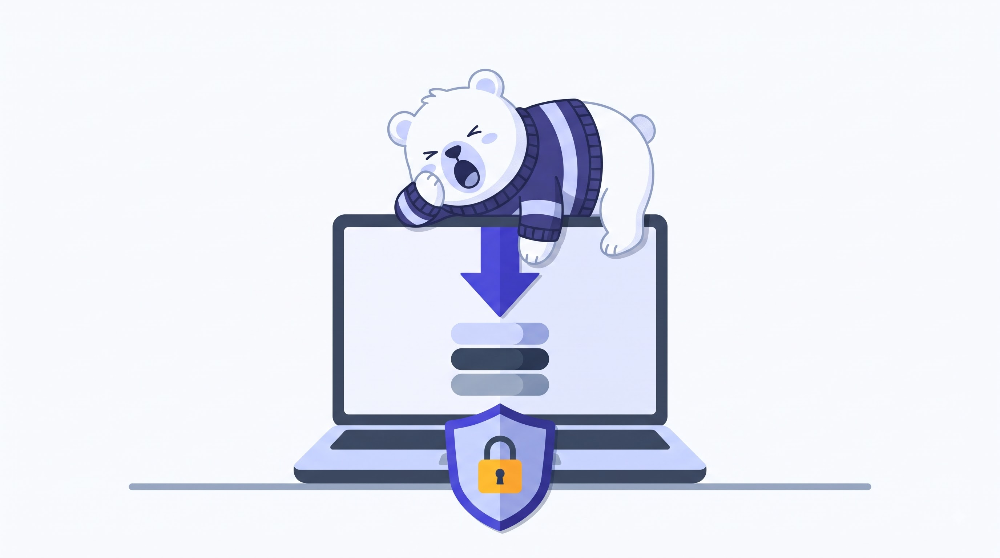
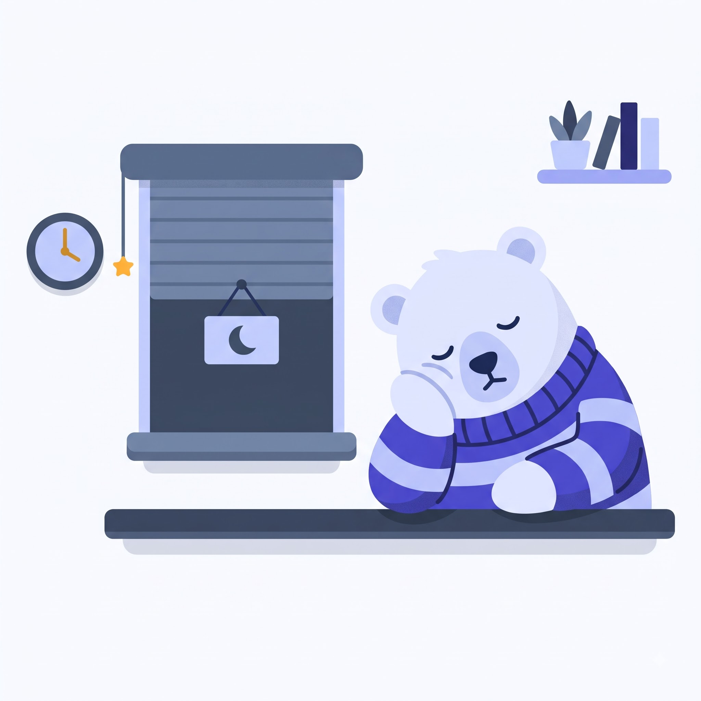
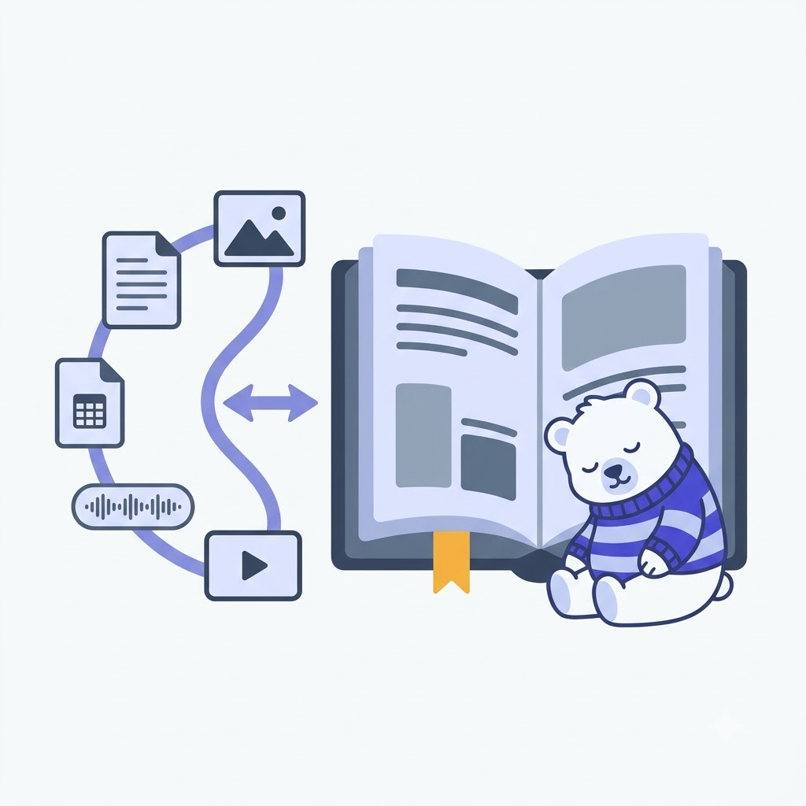
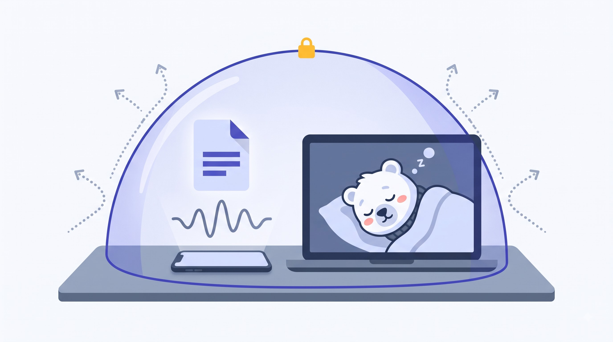

<p align="center">
  
  <br />
  
</p>

<h1 align="center">LazyTranslator</h1>

<p align="center">
  <strong>100% local, studio-grade translation, transcription &amp; OCR for macOS.</strong><br />
  Privacy-first native Rust app — no cloud, no telemetry, no files leaving your Mac.
</p>

<p align="center">
  <a href="https://lazytranslator.vercel.app"><strong>🏠 lazytranslator.vercel.app</strong></a>
</p>

<p align="center">
  <a href="https://github.com/FutureMindsDev/homebrew-lazytranslator/releases/latest"></a>
  <a href="https://github.com/FutureMindsDev/homebrew-lazytranslator/releases"></a>
  
  
  <a href="#option-2-install-via-homebrew"></a>
</p>

---

**LazyTranslator** is a 100% local, privacy-first native macOS desktop app for studio-grade document translation, audio/video transcription, subtitle generation, and PDF/image OCR across **21 languages** (including first-class Burmese `မြန်မာ` and CJK support)—powered by unified multilingual AI models tuned for **8 GB – 24 GB+ RAM** Macs with Apple Metal GPU acceleration.

> All document, OCR, transcription, and translation inference runs **100% locally on your Mac**. No files, transcripts, or translations ever leave your machine.

---

## ⬇️ Option 1: Direct `.dmg` Download (Recommended for Most Users)

<p align="center">
  <a href="https://github.com/FutureMindsDev/homebrew-lazytranslator/releases/latest"></a>
</p>

1. Download the latest **`LazyTranslator-v*-macos-arm64.dmg`** from [GitHub Releases](https://github.com/FutureMindsDev/homebrew-lazytranslator/releases/latest).
2. Double-click the downloaded `.dmg` file to open it.
3. Drag **`LazyTranslator.app`** into the **`Applications`** folder shortcut.
4. Launch **LazyTranslator** from **Applications** or Spotlight.

**Version-pinned direct link:** [LazyTranslator-v1.5.0-macos-arm64.dmg](https://github.com/FutureMindsDev/homebrew-lazytranslator/releases/download/v1.5.0/LazyTranslator-v1.5.0-macos-arm64.dmg) · SHA-256 `b3514fbd5f7b90c75448a57dada986654550c747a31e6a9a2a8bcdae1ee71517`

Verify the checksum after downloading:

```bash
shasum -a 256 ~/Downloads/LazyTranslator-v1.5.0-macos-arm64.dmg
```

<p align="center">
  
</p>

> **Gatekeeper Note (First Launch):** Until Apple Developer notarization is enabled, macOS Gatekeeper may display *"LazyTranslator is damaged and can't be opened"* or *"unidentified developer"* on first launch. To clear the quarantine flag safely, run:
> ```bash
> xattr -dr com.apple.quarantine /Applications/LazyTranslator.app
> ```
> Or open **System Settings → Privacy & Security** and click **Open Anyway**.

---

## 🍺 Option 2: Install via Homebrew

<p align="center">
  
</p>

Install directly from this tap and clear the macOS Gatekeeper quarantine flag (required until Apple notarization is enabled):

```bash
brew install --cask FutureMindsDev/lazytranslator/lazytranslator
xattr -dr com.apple.quarantine /Applications/LazyTranslator.app
```

*(Alternatively, after `brew install --cask FutureMindsDev/lazytranslator/lazytranslator`, you can open **System Settings → Privacy & Security** and click **Open Anyway**.)*

---

## ✨ What LazyTranslator Does

### 📄 Document Translation
<p align="center">
  
</p>

`21 languages` · `Burmese မြန်မာ` · `CJK` · `Hy-MT3 GGUF` · `8–24 GB RAM tiers`

Translate PDFs, Word documents, subtitles and plain text entirely on-device with Tencent Hy-MT3 quantized models.

### 🎧 Audio & Video Transcription
<p align="center">
  
</p>

`Whisper Large-v3 Turbo` · `SRT / VTT / TXT / MD` · `Metal acceleration`

Turn meetings, lectures and media into timestamped subtitles locally with whisper.cpp GGML models.

### 🔒 Privacy & Local OCR
<p align="center">
  
</p>

`100% on-device` · `Zero telemetry` · `Tesseract 5 / Qwen3-VL-8B OCR` · `Burmese OCR`

Scanned PDFs and images are read locally — even the model downloads happen only after your explicit consent.

---

## 🔄 Updating LazyTranslator

LazyTranslator **never** checks for updates in the background. You are always in control:

- **In-App 1-Click Update (Recommended):**
  1. Open **LazyTranslator** and click **🔄 Check for Updates** in the sidebar.
  2. If a newer version is available, click **Download & Install Update**.
  3. Once the SHA-256 checksum is verified, click **Install & Restart**. LazyTranslator automatically swaps the app bundle and relaunches—your downloaded AI models, glossary, and session history are preserved.
- **Via Homebrew:**
  ```bash
  brew upgrade --cask lazytranslator
  ```

---

## 🏷️ Versions, Tags & Downloads

Current release: **v1.5.0** — *Hy-MT3 translation (1.8B/7B/30B-A3B) + Qwen3-VL-8B OCR lineup, 24 GB Best tier*.

| Version | Released | Download |
| :--- | :--- | :--- |
| **v1.5.0** (latest) | 2026-11-27 | [.dmg](https://github.com/FutureMindsDev/homebrew-lazytranslator/releases/download/v1.5.0/LazyTranslator-v1.5.0-macos-arm64.dmg) |
| v1.4.0 | 2026-11-27 | [Release notes](https://github.com/FutureMindsDev/homebrew-lazytranslator/releases/tag/v1.4.0) |
| v1.3.2 | 2026-11-21 | [Release notes](https://github.com/FutureMindsDev/homebrew-lazytranslator/releases/tag/v1.3.2) |

- **[Browse all releases & download counts](https://github.com/FutureMindsDev/homebrew-lazytranslator/releases)**
- **[Browse all version tags](https://github.com/FutureMindsDev/homebrew-lazytranslator/tags)**
- **[Update manifest (`latest.json`)](https://github.com/FutureMindsDev/homebrew-lazytranslator/releases/latest/download/latest.json)**
- **[Homebrew Cask formula](Casks/lazytranslator.rb)**

---

## 💻 System Requirements & Local Storage

- **OS:** macOS 13.0 (Ventura) or newer
- **Architecture:** Apple Silicon (`arm64` — M1, M2, M3, M4 series)
- **Memory:** 8 GB RAM minimum (`Lite` tier) · 16 GB RAM recommended (`Balanced`) · 24 GB+ (`Best`)
- **Local Storage:** Downloaded AI model weights, glossary terms, and session history are stored locally in:
  ```
  ~/Library/Application Support/com.lazytranslator.app/
  ```
  Depending on your chosen model tier, plan for **1 GB – 16 GB** of free disk space for cached models.

---

## 🔗 Links

- **Homepage:** [lazytranslator.vercel.app](https://lazytranslator.vercel.app)
- **Downloads & releases:** [GitHub Releases](https://github.com/FutureMindsDev/homebrew-lazytranslator/releases/latest)
- **Homebrew tap:** `brew tap FutureMindsDev/lazytranslator`
